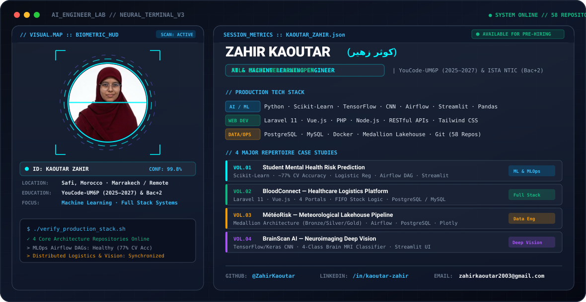

<div align="center">
  <picture>
    <source media="(prefers-color-scheme: dark)" srcset="./dark.svg">
    <source media="(prefers-color-scheme: light)" srcset="./light.svg">
    
  </picture>
</div>

<br>

<div align="center">
  <a href="https://github.com/ZahirKaoutar"></a>
  <a href="https://www.linkedin.com/in/kaoutar-zahir-39a024284/"></a>
  <a href="mailto:zahirkaoutar2003@gmail.com"></a>
  
  
</div>

---

### 🏛️ The Intelligence Archive // Kaoutar Zahir

> *"I turn data into intelligence and ideas into systems."*

Hi 👋, I'm **Kaoutar Zahir** (`كوثر زهير`), an **AI / Machine Learning Engineer & Full Stack Developer** based in **Safi, Morocco** (Mobility: Marrakech and Remote). 

Holding an Associate Degree in Digital Development (**ISTA NTIC Bac+2**) and currently engineering full-stack architectures and machine learning systems at **YouCode-UM6P** (2025–2027). I bridge the gap between rigorous statistical modeling and production software: from scikit-learn & deep learning vision architectures to Medallion data pipelines and robust web systems.

---


### 💼 Verified Professional Experience

* **INVENEO | Full Stack Developer Intern** *(May 2026 – July 2026 • Marrakech)*
  * Built *Job Portal*, a LinkedIn-inspired recruitment web platform (job postings, candidates, company profiles).
  * Developed employer analytics dashboard with real-time statistics, modular admin interface, and containerized REST APIs.
  * *Technologies*: `Node.js`, `Vue.js`, `PostgreSQL`, `Docker`, `Tailwind CSS`, `JavaScript`

* **Province de Safi | Python Developer Intern** *(July 2024 – August 2024 • Safi)*
  * Developed a standalone desktop software application to automate official administrative document generation and printing workflows.
  * *Technologies*: `Python`, `PDF Generation`, `Desktop UI`, `Git`

* **Sabri Joud | Laravel Developer Intern** *(April 2024 – May 2024 • Safi)*
  * Designed and built an e-commerce web platform with catalog management, cart flows, and an intuitive admin backoffice using Filament and Livewire.
  * *Technologies*: `Laravel`, `PHP`, `Livewire`, `Filament`, `JavaScript`, `MySQL`

---

### 🛠️ Verified Technical Repertoire

```text
┌───────────────────────────┬────────────────────────────────────────────────────────┐
│ DOMAIN                    │ PRACTICED TECHNOLOGIES                                 │
├───────────────────────────┼────────────────────────────────────────────────────────┤
│ AI & Machine Learning     │ Python, Scikit-learn, TensorFlow, Keras, CNN, YOLOv8,   │
│                           │ Pandas, NumPy, GridSearchCV, Macro F1, Streamlit       │
├───────────────────────────┼────────────────────────────────────────────────────────┤
│ Back-End & Architecture   │ Laravel, PHP, Livewire, Filament, Node.js, Python,     │
│                           │ Langage C, RESTful APIs, OOP, Design Patterns          │
├───────────────────────────┼────────────────────────────────────────────────────────┤
│ Front-End & Interfaces    │ Vue.js, React, JavaScript (ES6+), TypeScript,          │
│                           │ Tailwind CSS, HTML5, CSS3, Bootstrap                   │
├───────────────────────────┼────────────────────────────────────────────────────────┤
│ Databases & Storage       │ PostgreSQL, MySQL, MongoDB, SQLite, Relational Schemas │
├───────────────────────────┼────────────────────────────────────────────────────────┤
│ Data & DevOps             │ Apache Airflow, Medallion Architecture, Docker,        │
│                           │ Git & GitHub (58 Repos), UML, Jira, Agile (Scrum)      │
└───────────────────────────┴────────────────────────────────────────────────────────┘
```

---

### 🎓 Academic Trajectory

* **YouCode - UM6P Safi** *(2025 – 2027, In progress)* : Full Stack Web Development & Artificial Intelligence
* **ISTA NTIC Safi** *(2022 – 2024)* : Specialized Technician in Digital Development (Bac+2)
* **Lycée El Hidaya Issalmiya Safi** *(2021 – 2022)* : High School Diploma in Physical Sciences

---

### 📬 Connect & Collaborate

* **Email**: [zahirkaoutar2003@gmail.com](mailto:zahirkaoutar2003@gmail.com)
* **Phone**: `+212 7 71 96 29 60`
* **LinkedIn**: [linkedin.com/in/kaoutar-zahir](https://www.linkedin.com/in/kaoutar-zahir-39a024284/)
* **GitHub**: [@ZahirKaoutar](https://github.com/ZahirKaoutar)
* **Portfolio**: [The Intelligence Archive](https://github.com/ZahirKaoutar/portfolio)

---

<div align="center">
  <sub>Generated with engineering rigor for Kaoutar Zahir · The Intelligence Archive</sub>
</div>
